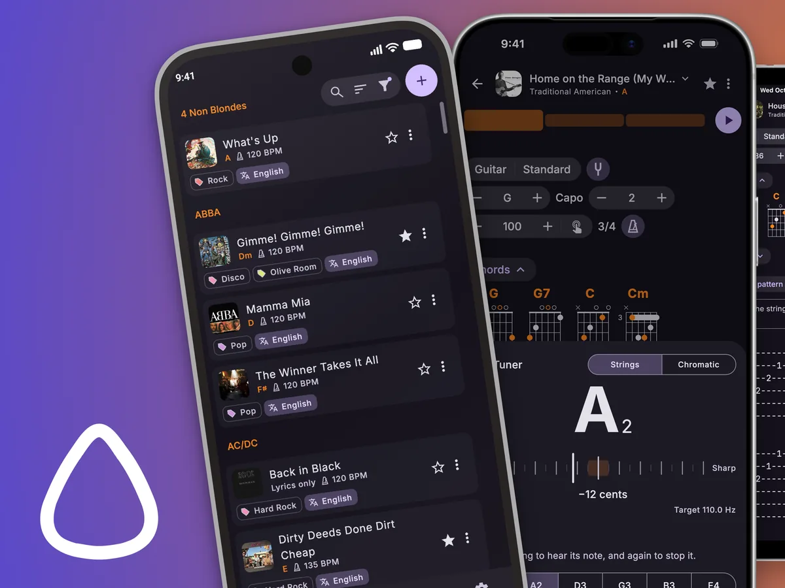
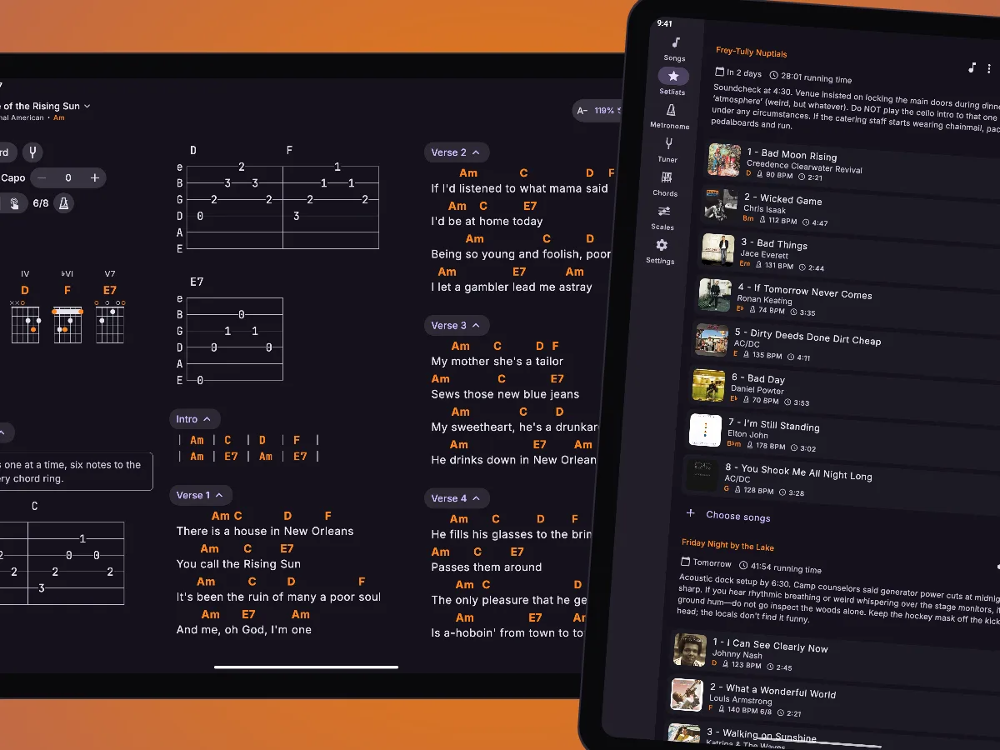
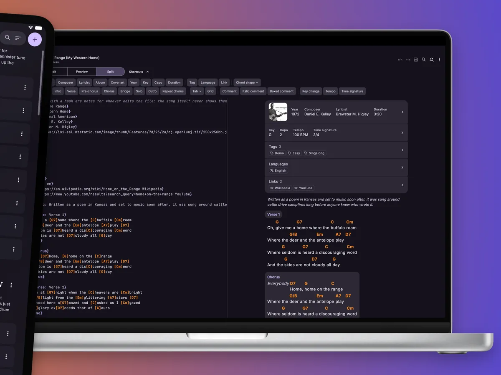
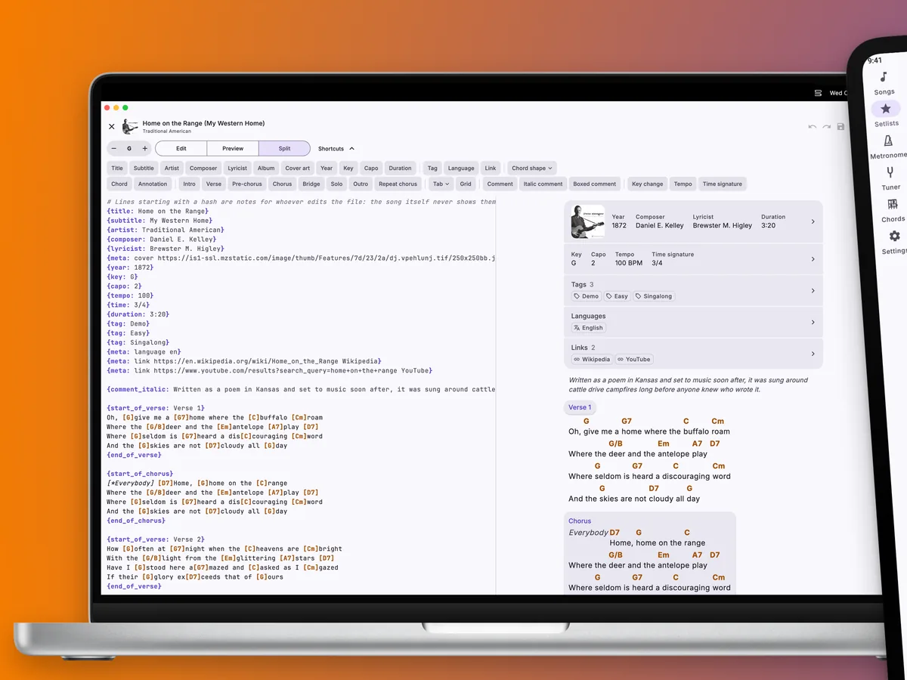
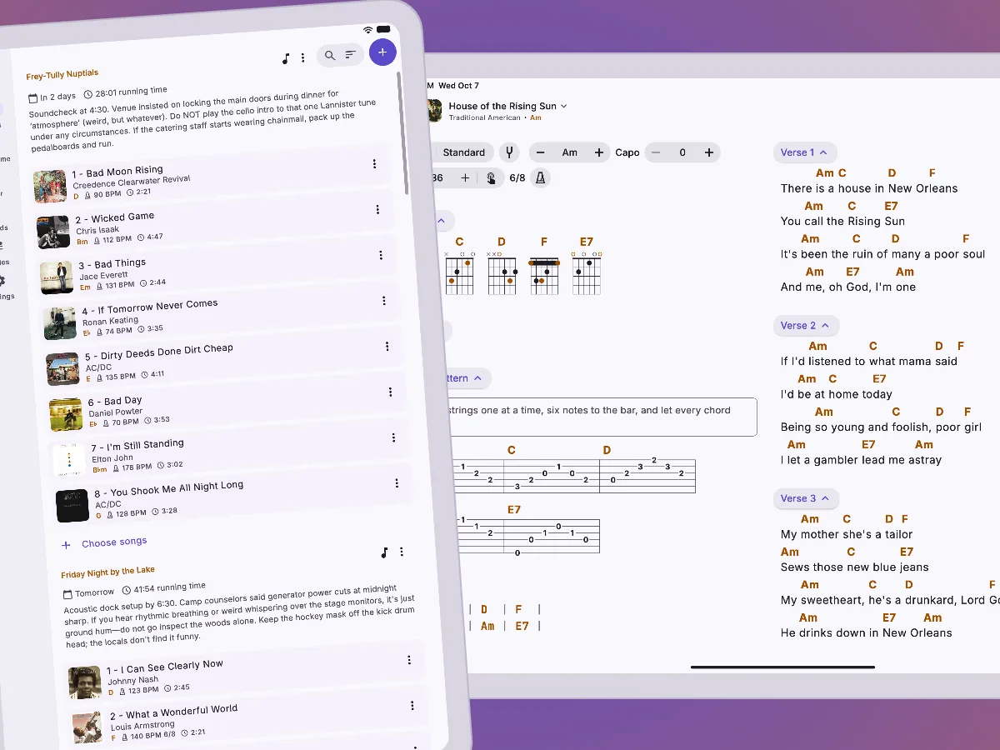
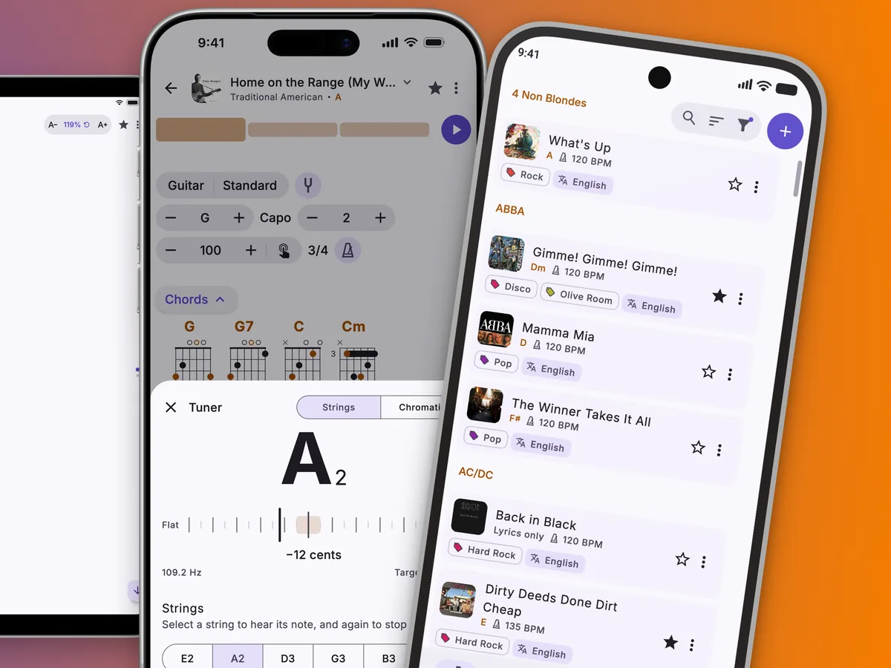

<!--
 * This file is part of Campfire.
 * Copyright (c) Pandula Péter 2017-2026.
 * https://github.com/pandulapeter/campfire
 *
 * This Source Code Form is subject to the terms of the Mozilla Public License, v. 2.0.
 * If a copy of the MPL was not distributed with this file, You can obtain one at
 * https://mozilla.org/MPL/2.0/.
-->
# Campfire
*Your songbook, on every screen you own.*

Campfire is a chord sheet viewer and editor built around the plain-text [ChordPro](https://www.chordpro.org/chordpro/chordpro-introduction/) format.
It runs natively on Android, iOS, macOS, Windows, Linux, and the web. 

  

The interface is designed around practical use, whether you’re organizing a song library, building setlists, or playing a gig, and a selection of songs can be filed into setlists, tagged, given languages, or exported in one go.
Songs automatically adapt with multi-column layouts and customizable section ordering to make reading easier on stage.
It also includes on-the-fly transposition, chord diagrams for guitar, ukulele, and keyboard (with every other way to play each chord one tap away, and the shapes a song defines for itself), adjustable font sizing, a lyrics-only view for singers, customizable themes, an optional lookup that fills in a song's artist, album, year, and songwriters from MusicBrainz and iTunes, a read only mode to lock the app against accidental edits, and a Features tab that switches off whatever a reader does not need, from the metronome and the tuner to the setlists.
A built-in metronome starts at each song's own tempo and time signature, with tap tempo, accents, subdivisions, and five sounds, and keeps clicking with the screen locked. Setlists can play a song in its own key, with its own capo and tempo, count down to the date of the gig, and add up their running time.
A tuner hears one string at a time through the microphone, chromatically or against the strings of a guitar, bass, ukulele, violin, mandolin or banjo, and plays each string's note for tuning by ear; nothing it hears is kept or sent anywhere, and it can be opened over the song being played.
Songs and setlists can be exported as printable PDFs, with a page preview, song selection, and saved paper, sizing and content options.

  

The app works offline (the web app after its first visit), requires no account, and doesn't rely on a central server. Syncing the library across devices is handled directly through your own Dropbox storage.
Campfire is free, open-source, and has no ads or tracking. Check out the [Privacy Policy](https://campfire-songbook.com/privacy/) for more information.

## Get Campfire

The app is currently available for the following platforms:

## Under the hood

Campfire is a [Kotlin Multiplatform](https://kotlinlang.org/docs/multiplatform.html) project targeting Android, iOS, desktop (JVM) and the web (Kotlin/Wasm).
The whole interface is written once with Compose Multiplatform and Material 3 Expressive, with navigation handled by Navigation 3 and dependencies wired together at compile time using Koin Annotations.
Platform-specific code is limited to thin shells: file pickers, system bars, share and "open with" intents, and the storage behind the library, which is a plain folder on Android, iOS and desktop and the Origin Private File System in the browser.

The code is split into small modules with a strict `api` / `implementation` boundary at every layer: a `presentation` module with the screens and the ViewModel, a `domain` layer of single-method use cases, repositories on top of local and remote data sources, and the `app` modules that hold each platform's entry point.
The ChordPro parser, transposer, and serializer live in a dependency-free `chordpro` module, so the format logic can be tested and reused independently of any UI or storage.
The metronome is a self-contained `metronome` module of its own: every click is placed by sample count rather than by a timer, so it never drifts, and its sounds are synthesized in Kotlin behind one audio output per platform. The `tuner` module beside it reads the microphone with the McLeod pitch method and plays its reference tones the same way.

Everything the app owns is a plain file: songs are `.cho` files and setlists are small JSON documents, so nothing is locked inside a database.
Syncing is a pure planning step over file hashes and a remote listing, run against a provider interface that Dropbox implements through OAuth with PKCE, which is why no backend of Campfire's own is needed.

## License

Copyright (c) Péter Pandula 2017-2026. This software is licensed under the
[Mozilla Public License 2.0](LICENSE).

The MPL is a file-level copyleft license, which means you are welcome to reuse any part of Campfire — the ChordPro
parser, the sync engine, a single screen — in your own project, open source or not. If you modify one of the files in
this repository, that file has to stay under the MPL and its source has to be available; anything new you write
alongside it is yours, under whatever license you choose.

The name *Campfire*, the app icon and the other branding assets are **not** covered by the license and remain the
author's. The MPL grants no trademark rights (section 2.3), so a fork has to ship under a name and an icon of its own.

### Third-party software

Campfire is built with the work of others, which keeps its own license. Each build lists what it ships, with the full
license texts and the projects' NOTICE files, under Settings → About → Open-source licenses; the table below is every
build's, from the Android, desktop, and web runtime dependencies. The texts are under `composeResources/files/licenses`
of the source set of the builds that ship them.

| Component | Copyright | License | Builds |
|---|---|---|---|
| [Accompanist](https://github.com/google/accompanist) Drawable Painter | Google | [Apache 2.0](presentation/src/commonMain/composeResources/files/licenses/apache_2.0.txt) | Android |
| [AndroidX](https://developer.android.com/jetpack/androidx) libraries (Activity, AppCompat, Browser, Core, Fragment, ProfileInstaller, and what they need) | The Android Open Source Project | [Apache 2.0](presentation/src/commonMain/composeResources/files/licenses/apache_2.0.txt) | Android |
| AndroidX [multiplatform](https://github.com/JetBrains/compose-multiplatform-core) libraries (Annotation, Collection, Graphics Shapes, Lifecycle, Navigation 3, NavigationEvent, SavedState) | The Android Open Source Project, JetBrains | [Apache 2.0](presentation/src/commonMain/composeResources/files/licenses/apache_2.0.txt) | All |
| [ANGLE](https://chromium.googlesource.com/angle/angle) | The ANGLE Project Authors | [BSD 3-Clause](presentation/src/desktopMain/composeResources/files/licenses/angle_bsd_3.txt) | Windows |
| [ChordPro](https://www.chordpro.org) chord shapes | The ChordPro Team | [Artistic 2.0](presentation/src/commonMain/composeResources/files/licenses/chordpro_artistic_2.0.txt) | All |
| [chords-db](https://github.com/tombatossals/chords-db) and [its fork by Tabsy](https://github.com/tabsy-gr/chords-db) chord shapes | David Rubert and the chords-db contributors, Tabsy contributors | [MIT](presentation/src/commonMain/composeResources/files/licenses/chords_db_mit.txt) | All |
| [Coil](https://github.com/coil-kt/coil) | Coil Contributors | [Apache 2.0](presentation/src/commonMain/composeResources/files/licenses/apache_2.0.txt) | All |
| [Compose Multiplatform](https://github.com/JetBrains/compose-multiplatform) and Material 3 | JetBrains, The Android Open Source Project | [Apache 2.0](presentation/src/commonMain/composeResources/files/licenses/apache_2.0.txt) | All |
| [DNG SDK](https://helpx.adobe.com/camera-raw/digital-negative.html), inside Skia | Adobe Systems Incorporated | [DNG SDK License](presentation/src/commonMain/composeResources/files/licenses/dng_sdk.txt) | iOS, macOS, Linux |
| [Expat](https://libexpat.github.io), inside Skia | Thai Open Source Software Center Ltd, Clark Cooper, and the Expat maintainers | [MIT](presentation/src/commonMain/composeResources/files/licenses/expat_mit.txt) | Desktop, iOS, web |
| [FreeType](https://freetype.org), inside Skia | David Turner, Robert Wilhelm, and Werner Lemberg (The FreeType Project) | [FreeType License](presentation/src/commonMain/composeResources/files/licenses/freetype_ftl.txt) | Linux, web |
| [Google Play In-App Updates](https://developer.android.com/guide/playcore/in-app-updates) and Play services | Google | [Play Core SDK Terms of Service](https://developer.android.com/guide/playcore/license), and [the licenses of what it bundles](presentation/src/androidMain/composeResources/files/licenses/google_play_third_party_licenses.txt) | Android |
| [Guava](https://github.com/google/guava) ListenableFuture | The Guava Authors | [Apache 2.0](presentation/src/commonMain/composeResources/files/licenses/apache_2.0.txt) | Android |
| [HarfBuzz](https://harfbuzz.github.io), inside Skia | Google, Behdad Esfahbod, and the other HarfBuzz authors | [Old MIT](presentation/src/commonMain/composeResources/files/licenses/harfbuzz_mit.txt) | Desktop, iOS, web |
| [ICU](https://icu.unicode.org), inside Skia | Unicode, Inc. | [Unicode License V3](presentation/src/commonMain/composeResources/files/licenses/icu_unicode_3.txt) | Desktop, iOS, web |
| [Inter](https://github.com/rsms/inter) | The Inter Project Authors | [SIL Open Font License 1.1](presentation/src/wasmJsMain/composeResources/files/licenses/inter_ofl.txt) | Web |
| [JetBrains Annotations](https://github.com/JetBrains/java-annotations) | JetBrains | [Apache 2.0](presentation/src/commonMain/composeResources/files/licenses/apache_2.0.txt) | Android, desktop |
| [JetBrains Mono](https://github.com/JetBrains/JetBrainsMono) | The JetBrains Mono Project Authors | [SIL Open Font License 1.1](presentation/src/wasmJsMain/composeResources/files/licenses/jetbrains_mono_ofl.txt) | Web |
| [JetBrains Runtime](https://github.com/JetBrains/JetBrainsRuntime) | Oracle and/or its affiliates, JetBrains | [GPL 2.0 with the Classpath Exception](presentation/src/desktopMain/composeResources/files/licenses/openjdk_gpl_2.0_classpath_exception.txt) ([additional information](presentation/src/desktopMain/composeResources/files/licenses/jetbrains_runtime_additional_license_info.txt)) | Desktop |
| [JetBrains Runtime API](https://github.com/JetBrains/JetBrainsRuntimeApi) | JetBrains | [Apache 2.0](presentation/src/commonMain/composeResources/files/licenses/apache_2.0.txt) | Desktop |
| [JSpecify](https://jspecify.dev) | The JSpecify Authors | [Apache 2.0](presentation/src/commonMain/composeResources/files/licenses/apache_2.0.txt) | Android, desktop |
| [Koin](https://github.com/InsertKoinIO/koin) | Kotzilla, Koin contributors | [Apache 2.0](presentation/src/commonMain/composeResources/files/licenses/apache_2.0.txt) | All |
| [Kotlin](https://kotlinlang.org) and kotlinx (coroutines, serialization, datetime, io, atomicfu, browser) | JetBrains, Kotlin contributors | [Apache 2.0](presentation/src/commonMain/composeResources/files/licenses/apache_2.0.txt) ([NOTICE](presentation/src/commonMain/composeResources/files/licenses/kotlin_notice.txt)) | All |
| [Ktor](https://github.com/ktorio/ktor) | JetBrains, Ktor contributors | [Apache 2.0](presentation/src/commonMain/composeResources/files/licenses/apache_2.0.txt) | All |
| [libjpeg-turbo](https://libjpeg-turbo.org), inside Skia | The libjpeg-turbo Project, D. R. Commander, the Independent JPEG Group | [IJG, BSD 3-Clause, and zlib](presentation/src/commonMain/composeResources/files/licenses/libjpeg_turbo.txt) | Desktop, iOS, web |
| [libpng](http://www.libpng.org/pub/png/libpng.html), inside Skia | The PNG Reference Library Authors, Cosmin Truta, Glenn Randers-Pehrson, and the other libpng authors | [PNG Reference Library License version 2](presentation/src/commonMain/composeResources/files/licenses/libpng_2.txt) | Desktop, iOS, web |
| [libwebp](https://chromium.googlesource.com/webm/libwebp), inside Skia | Google | [BSD 3-Clause](presentation/src/commonMain/composeResources/files/licenses/libwebp_bsd_3.txt) ([PATENTS](presentation/src/commonMain/composeResources/files/licenses/libwebp_patents.txt)) | Desktop, iOS, web |
| [OkHttp](https://github.com/square/okhttp) | Square | [Apache 2.0](presentation/src/commonMain/composeResources/files/licenses/apache_2.0.txt) | Android |
| [Okio](https://github.com/square/okio) | Square | [Apache 2.0](presentation/src/commonMain/composeResources/files/licenses/apache_2.0.txt) | All |
| [piex](https://github.com/google/piex), inside Skia | Google | [Apache 2.0](presentation/src/commonMain/composeResources/files/licenses/apache_2.0.txt) | iOS, macOS, Linux |
| [Public Suffix List](https://publicsuffix.org), inside OkHttp | Mozilla Foundation | [MPL 2.0](presentation/src/commonMain/composeResources/files/licenses/mpl_2.0.txt) | Android |
| [Reorderable](https://github.com/Calvin-LL/Reorderable) | Calvin Liang | [Apache 2.0](presentation/src/commonMain/composeResources/files/licenses/apache_2.0.txt) | All |
| [Skia](https://skia.org) | Google | [BSD 3-Clause](presentation/src/commonMain/composeResources/files/licenses/skia_bsd_3.txt) | Desktop, iOS, web |
| [Skiko](https://github.com/JetBrains/skiko) | JetBrains | [Apache 2.0](presentation/src/commonMain/composeResources/files/licenses/apache_2.0.txt) ([NOTICE](presentation/src/commonMain/composeResources/files/licenses/skiko_notice.txt)) | Desktop, iOS, web |
| [SLF4J](https://www.slf4j.org) | QOS.ch | [MIT](presentation/src/commonMain/composeResources/files/licenses/slf4j_mit.txt) | Android, desktop |
| [Stately](https://github.com/touchlab/Stately) | Touchlab | [Apache 2.0](presentation/src/commonMain/composeResources/files/licenses/apache_2.0.txt) | All |
| [Wuffs](https://github.com/google/wuffs), inside Skia | The Wuffs Authors | [Apache 2.0](presentation/src/commonMain/composeResources/files/licenses/apache_2.0.txt) | Desktop, iOS, web |
| [zlib](https://zlib.net), inside Skia | Jean-loup Gailly and Mark Adler | [zlib License](presentation/src/commonMain/composeResources/files/licenses/zlib.txt) | Desktop, iOS, web |

The chord shapes from chords-db and ChordPro were checked and reordered for Campfire; each table's source file names
where its shapes came from.
